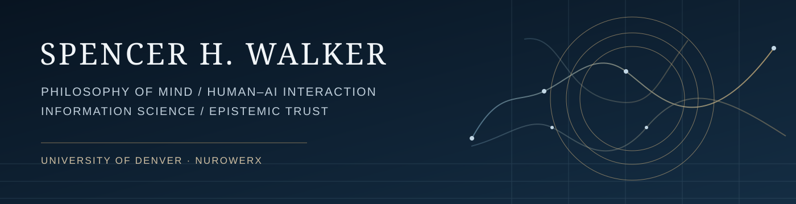

# Spencer H. Walker

**Philosophy of Mind · Human–AI Interaction · Information Science**  
**University of Denver**, undergraduate philosophy studies · **Founder & CEO, Nurowerx**

I investigate the relationship between **human cognition and artificial intelligence**. My interests sit at the intersection of epistemology, philosophy of mind, cognitive science, information science, and human–computer interaction. In particular, I am interested in how conversational AI influences people's judgments of intelligence, understanding, authority, and reliability.

My guiding distinction is between **a system appearing to understand** and **a system demonstrating reliable, verifiable reasoning**. Fluent conversation alone is not proof of accuracy or understanding. But interaction design can influence both the practical value of an AI system and the confidence users place in it.

## Featured research proposal

### When AI Appears to Understand: Conversational Realism, Memory, and Epistemic Trust

> **How do persistent conversational memory, naturalistic speech, and contextual inference affect the difference between an AI system's actual reliability and a user's perception of its intelligence and trustworthiness?**

This proposed interdisciplinary investigation, developed in the context of University of Denver philosophy studies, examines three hypotheses:

1. **Memory fidelity:** accurate retrieval of relevant prior information improves multi-turn performance; erroneous or incomplete memories can increase unsupported inference and false personalization.
2. **Conversational realism:** natural, expressive speech can increase perceived intelligence or competence even when answer quality remains unchanged.
3. **Trust calibration:** explicit uncertainty, verifiable source attribution, and opportunities to correct the system can bring user confidence and reliance into closer alignment with measured accuracy.

The study aims to compare **objective task performance** with **subjective impressions of intelligence, understanding, and trustworthiness**, and to measure how those impressions influence verification, delegation, and correction.

**Status:** Research agenda and proposed design in development. A related **Epistemic Trust Lab** evaluation instrument has been implemented locally and reportedly run against synthetic, deterministic scenarios; its results do not validate the real-model or human-participant hypotheses. No institutional sponsorship, grant, or approved human-subject protocol is claimed.

**[Research agenda](research/HUMAN-AI-INTERACTION-AGENDA.md)** · **[Proposed study design](research/HUMAN-AI-INTERACTION-STUDY-DESIGN.md)**

## Larger philosophical questions

| Area | Guiding questions |
| --- | --- |
| Epistemology | When is confidence in an AI system justified by evidence rather than fluency? |
| Philosophy of mind | What leads humans to attribute understanding, intentionality, consciousness, or moral standing to artificial systems? |
| Cognition and agency | When does AI extend human reasoning, and when does dependence weaken oversight or independent judgment? |
| Information science | How do memory, interface design, linguistic realism, and social context shape perceived expertise and authority? |
| Responsible AI | How can provenance, uncertainty, transparency, and correction reduce overreliance while preserving usability? |

## Relevant engineering and research portfolio

- **[Epistemic Trust Lab — project overview](https://github.com/SWALKERNURO/SWALKERNURO/blob/main/projects/EPISTEMIC-TRUST-LAB.md):** implemented local synthetic evaluation instrument for examining contextual memory and evidential support. Reported: 240 synthetic scenarios, 5,760 deterministic policy evaluations, dashboard, exports, and 34 passing automated tests. Full code and live demo pending release; real-model and human-participant validation not yet performed.

- **[Living Field](https://github.com/SWALKERNURO/living-field):** exploratory EEG/EOG research visualization, comparisons among recording conditions, and explicit limits on interpretation.
- **[Pink Noise Relational Field / NoiseColor](https://github.com/SWALKERNURO/pink-noise-relational-field):** measured EEG/EOG temporal visualization and local-first spectral audio analysis with inspectable diagnostics.
- **[Flux EEG](https://github.com/SWALKERNURO/flux-eeg):** local-first EEG research workflow with spectral analysis, condition comparisons, provenance, and methodological documentation.
- **Related private development:** conversational agents, voice interaction, retrieval and persistent context, tool-assisted research, and permission-aware workflows. These are engineering contexts motivating the proposal, not evidence that the proposed experimental study has already been carried out.

These projects demonstrate an interest in reproducible measurement and the distinction between observation and interpretation. EEG findings are exploratory and do not provide evidence that consciousness has been detected or measured.

## Research principles

**Separate observed performance from perceived intelligence.**  
**Make uncertainty, provenance, and corrections visible.**  
**Protect human agency and meaningful oversight.**  
**Do not confuse persuasive interfaces with epistemic warrant.**

## Education and professional background

- **University of Denver:** Undergraduate philosophy studies concentrating on philosophy of mind, consciousness, metaphysics, and philosophy of science.
- **University of Arizona:** B.S. in Neuroscience & Cognitive Science.
- **Nurowerx:** Founder & CEO; AI, neurotechnology, and research software development.

The University of Denver affiliation here refers to **student enrollment and the context in which this independent proposal is being developed**. It does not imply university sponsorship, faculty endorsement, ethics approval, or funding.

**Contact:** [swalker@nurowerx.com](mailto:swalker@nurowerx.com) · [GitHub](https://github.com/SWALKERNURO)
